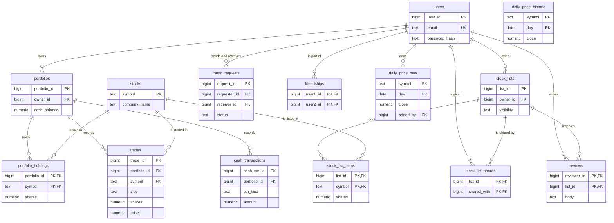

# Stock Database


A stock portfolio manager on PostgreSQL, driven from a command-line shell written in Java.
Users keep portfolios, record trades, build watch lists, share them with friends and review them.
The statistics (volatility, beta, correlation) are computed in SQL over 619,040 daily prices of 505 S&P 500 stocks.

| | |
|---|---|
| **Schema** | 14 tables, 1 view, 12 indexes, with foreign keys and check constraints |
| **Data** | 619,040 daily prices, 505 symbols, 2013-02-08 to 2018-02-07 (`SP500History.csv`) |
| **Load time** | About 7 seconds for the whole file on a laptop, and it can be loaded again without creating duplicates |
| **Analytics** | One SQL statement per report: common table expressions, window functions, `covar_pop`, `var_pop`, `corr` |
| **Code** | 43 Java files, 40 commands in 8 groups, plain JDBC with a connection pool |

## Contents

- [What it does](#what-it-does)
- [Data model](#data-model)
- [A short session](#a-short-session)
- [Analytics in SQL](#analytics-in-sql)
- [Design notes](#design-notes)
- [Run it](#run-it)
- [Commands](#commands)
- [Project layout](#project-layout)
- [Limits](#limits)

## What it does

- **Accounts.** Register, log in and log out. Passwords are stored as bcrypt hashes, and emails are unique without regard to case.
- **Portfolios.** Deposit and withdraw cash, buy and sell shares, and see holdings valued at the latest close.
- **Friends.** Send, accept, reject and cancel friend requests, and remove a friend.
- **Stock lists.** A list is private, visible to friends, or public. A private list can be shared with chosen friends.
- **Reviews.** One review per user per list, which the reviewer can edit and the reviewer or the list owner can delete.
- **Prices.** Load a CSV of historic prices, or add a single day. A newly added price replaces the historic one for that day.
- **Analytics.** Average close, volatility, coefficient of variation and beta for each stock, a covariance and correlation matrix, price history, and a straight-line forecast.

## Data model



The full definition is in [`postgres/init/01-schema.sql`](postgres/init/01-schema.sql). A few rules live in the schema itself:

- A friendship is stored once, with `check (user1_id < user2_id)`, so the pair (A, B) and the pair (B, A) cannot both exist.
- `portfolio_holdings.shares` can never go below zero, and a trade's side must be `BUY` or `SELL`.
- A friend request cannot be sent to oneself, and its status is one of four values.
- Prices sit in two tables. `daily_price_historic` holds the bulk file, and `daily_price_new` holds the days users add later. The view `unified_prices` puts them together and lets a new price replace the historic one for the same symbol and day:

```sql
create or replace view unified_prices as
select symbol, day, open, high, low, close, volume, added_by, added_at from daily_price_new
union all
select h.symbol, h.day, h.open, h.high, h.low, h.close, h.volume, null::bigint, null::timestamptz
from daily_price_historic h
left join daily_price_new n on n.symbol = h.symbol and n.day = h.day
where n.symbol is null;
```

## A short session

Everything below is the output of a real run against PostgreSQL 16.

**Trading.** A sell of more shares than the portfolio holds is refused, and nothing changes.

```text
cscc43> prices import --file SP500History.csv
Imported prices from SP500History.csv
cscc43> portfolios create --name "Core"
Created portfolio Core with id 1
cscc43> portfolios deposit --portfolio-id 1 --amount 10000
New cash balance: 10000.00
cscc43> portfolios buy --portfolio-id 1 --symbol AAPL --shares 10 --price 159.54
Trade recorded. Cash balance: 8404.60
cscc43> portfolios buy --portfolio-id 1 --symbol MSFT --shares 20 --price 89.61
Trade recorded. Cash balance: 6612.40
cscc43> portfolios buy --portfolio-id 1 --symbol JPM --shares 15 --price 112.87
Trade recorded. Cash balance: 4919.35
cscc43> portfolios sell --portfolio-id 1 --symbol MSFT --shares 5 --price 91.00
Trade recorded. Cash balance: 5374.35
cscc43> portfolios sell --portfolio-id 1 --symbol MSFT --shares 500 --price 91.00
Error: Not enough shares to sell
cscc43> portfolios summary --portfolio-id 1
Portfolio Core | Cash 5374.35 | Total 10006.9500
Holdings:
- AAPL | shares 10.000000 | last close 159.5400 | market value 1595.4000
- JPM | shares 15.000000 | last close 112.8700 | market value 1693.0500
- MSFT | shares 15.000000 | last close 89.6100 | market value 1344.1500
Holdings market value: 4632.6000
```

**Analytics.** The benchmark here is MSFT, so MSFT's own beta comes out as exactly 1. That is a quick check on the query.

```text
cscc43> analytics portfolio --portfolio-id 1 --lookback-days 180 --market MSFT
Symbol | Avg Close | Volatility | COV | Beta
AAPL | 165.702 | 7.85344 | 0.047395 | 0.595538
JPM | 100.995 | 7.79843 | 0.0772157 | 0.271665
MSFT | 81.4307 | 6.39033 | 0.0784756 | 1
Correlations (A vs B | covariance | correlation):
AAPL vs AAPL | 0.000147457 | 1
AAPL vs JPM | 0.0000367987 | 0.288113
AAPL vs MSFT | 0.0000873036 | 0.593798
JPM vs JPM | 0.000110631 | 1
JPM vs MSFT | 0.000039825 | 0.312721
MSFT vs MSFT | 0.000146596 | 1
cscc43> analytics predict --symbol AAPL --horizon-days 3
Predictions for AAPL:
- 2018-02-08 | predicted close 175.164
- 2018-02-09 | predicted close 175.319
- 2018-02-10 | predicted close 175.473
```

**Sharing.** Bob cannot see Alice's friends-only list until he accepts her request.

```text
cscc43> auth login --email bob@example.com --password hunter2
Logged in as Bob (bob@example.com)
cscc43> lists accessible
No accessible lists
cscc43> friends respond --request-id 1 --action accept
Request 1 marked as accept
cscc43> lists accessible
Accessible lists:
- 1 | Tech Watch | visibility FRIENDS | owner 1 | created 2026-11-24T23:07:59.339576Z | access friends
cscc43> reviews upsert --list-id 1 --body "Looks diversified, a bit heavy on chips"
Saved review for list 1 by Bob <bob@example.com> [id 2]
```

## Analytics in SQL

The per-stock report is a single statement. The database does the arithmetic, and Java only prints the rows.
The query is in [`AnalyticsService.java`](src/main/java/cscc43/service/AnalyticsService.java), laid out here for reading:

```sql
with price as (
    select symbol, day, close
    from unified_prices
    where symbol = any(?) and day between ? and ?
),
close_stats as (
    select symbol, avg(close) as avg_close, stddev_pop(close) as volatility
    from price
    group by symbol
),
returns as (                      -- daily return: today's close against the previous close
    select symbol, day,
           (close - lag(close) over (partition by symbol order by day))
             / nullif(lag(close) over (partition by symbol order by day), 0) as ret
    from price
),
returns_filtered as (select symbol, day, ret from returns where ret is not null),
market_price as (
    select day, close from unified_prices where symbol = upper(?) and day between ? and ?
),
market_returns as (
    select day,
           (close - lag(close) over (order by day))
             / nullif(lag(close) over (order by day), 0) as ret
    from market_price
),
market_filtered as (select day, ret from market_returns where ret is not null),
beta_stats as (                   -- line each stock's returns up with the benchmark's, day by day
    select rf.symbol,
           covar_pop(rf.ret, mf.ret) as covariance,
           var_pop(mf.ret)           as market_variance
    from returns_filtered rf
    join market_filtered mf on mf.day = rf.day
    group by rf.symbol
)
select cs.symbol, cs.avg_close, cs.volatility,
       case when cs.avg_close = 0 then null else cs.volatility / cs.avg_close end as cov,
       case when bs.market_variance is null or bs.market_variance = 0 then null
            else bs.covariance / bs.market_variance end as beta
from close_stats cs
left join beta_stats bs on bs.symbol = cs.symbol
order by cs.symbol;
```

- **Volatility** is the standard deviation of the closing price over the window, and **COV** is that divided by the average close.
- **Beta** is the covariance of the stock's daily returns with the benchmark's, divided by the variance of the benchmark's returns.
- The **correlation matrix** comes from a second statement, which joins the returns to themselves on the day and applies `covar_pop` and `corr` to every pair.
- The window ends on the most recent day that has a price for the stocks asked about, not on today's date. So `--lookback-days 180` gives a real answer on a history that stops in 2018.
- The **forecast** fits a least-squares line to the last 365 days of closes and extends it. It is a simple model, and it is here to show the data path, not to predict the market.

## Design notes

- **A trade is one transaction.** It locks the portfolio row with `select ... for update`, checks the cash or the shares, inserts the trade, updates the holding and updates the cash. If any step fails, the whole thing rolls back. Two sessions trading in the same portfolio wait for each other, so they cannot overspend it.
- **Holdings are kept with an upsert.** A buy runs `insert ... on conflict (portfolio_id, symbol) do update`, and a holding that reaches zero is deleted.
- **Access to a list is decided by one query.** It checks the four ways a user can see a list (owner, shared, friend of the owner, public) with `union all` and returns the first that applies. Commands on lists and reviews go through it.
- **The bulk load is safe to repeat.** Rows go in JDBC batches of 500, one transaction per batch, with `on conflict (symbol, day) do nothing`. Loading the file a second time leaves the row count at 619,040.
- **Connections are pooled** with HikariCP, with auto-commit off. Every statement is a `PreparedStatement`, so user input never becomes part of the SQL text.

## Run it

You need Java 21 or later, Maven, and Docker.

```bash
docker compose up -d      # PostgreSQL 16 on port 5433; the schema is created on first start
mvn clean package
mvn exec:java             # opens the shell
```

Then, at the `cscc43>` prompt:

```text
users register --name "Alice" --email alice@example.com --password secret
auth login --email alice@example.com --password secret
prices import --file SP500History.csv
portfolios create --name "Core"
portfolios deposit --portfolio-id 1 --amount 10000
portfolios buy --portfolio-id 1 --symbol AAPL --shares 10 --price 159.54
analytics portfolio --portfolio-id 1 --lookback-days 180 --market AAPL
```

`help` lists the command groups, `<command> --help` shows the options of one command, and `exit` leaves the shell. `docker compose down` stops the database, and `docker compose down -v` also deletes its data.

To use another PostgreSQL server, load `postgres/init/01-schema.sql` into it and set these variables before starting the shell. The values shown are the defaults.

| Variable | Default |
|---|---|
| `DB_URL` | `jdbc:postgresql://127.0.0.1:5433/cscc43` |
| `DB_USER` | `cscc43` |
| `DB_PASSWORD` | `cscc43` |
| `DB_POOL_SIZE` | `8` |

## Commands

| Group | Commands |
|---|---|
| `users` | `register`, `list` |
| `auth` | `login`, `logout`, `whoami` |
| `portfolios` | `create`, `list`, `deposit`, `withdraw`, `buy`, `sell`, `holdings`, `summary` |
| `friends` | `request`, `respond`, `cancel`, `incoming`, `outgoing`, `list`, `remove` |
| `lists` | `create`, `mine`, `accessible`, `items`, `add-item`, `remove-item`, `update-visibility`, `share`, `unshare`, `shared-with`, `delete` |
| `reviews` | `upsert`, `list`, `delete` |
| `prices` | `import`, `add` |
| `analytics` | `portfolio`, `list`, `history`, `predict` |

The price file has one row per stock per day, in this column order: date, open, high, low, close, volume, symbol. The first line is a header and is skipped.

## Project layout

```text
postgres/init/01-schema.sql     tables, indexes and the unified_prices view
docker-compose.yml              PostgreSQL 16 for local use
SP500History.csv                619,040 daily prices
src/main/java/cscc43/
  Main.java                     wires the services together and runs the shell
  cli/                          one class per command group (Picocli)
  service/                      the SQL: portfolios, friends, lists, reviews, prices, analytics
  db/                           connection pool and the transaction helper
  model/                        records for rows and results
  auth/, config/                the logged-in user and the database settings
```

## Limits

- There are no automated tests yet. The behaviour described here was checked by running the commands against PostgreSQL 16.
- The price file holds the S&P 500 stocks only. Beta needs a benchmark, so pass `--market` with a symbol that has prices, or load an index series first. The default, `SPY`, is not in the file.
- `--password` can be given on the command line, where it stays in the terminal's history. Leave the value off and the shell asks for it without showing what is typed.
- A private list shared with a friend stays shared after the friendship ends.
